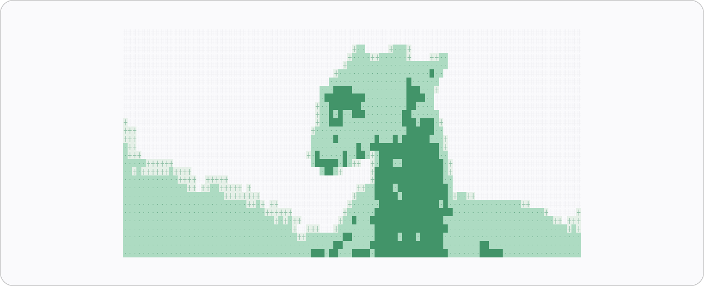

<picture>
  <source media="(prefers-color-scheme: dark)" srcset="assets/banner-dark.png">
  <source media="(prefers-color-scheme: light)" srcset="assets/banner-light.png">
  
</picture>

# Kilgharrah

A desktop manager for the skills and MCP servers a CLI agent loads. Install from the ClawHub
registry, keep your own skills in category folders, and flip one off without deleting its files.

The first launch asks three questions: where you work, which agent loads the skills, and whether
to start with a profile. The answers decide the folder layout, so a new user never has to move
files by hand.

The Home section opens first: a medieval display wordmark, a short description, live counts, and
an ASCII dragon flapping.

## What it touches

| Path | Role |
| --- | --- |
| `~/.agents/kilgharrah/skills/<category>/<slug>/` | The library. One folder per skill, grouped by category. |
| `~/.agents/kilgharrah/settings.json` | Setup answers, agent mirrors, and the MCP mirror record. |
| `~/.agents/kilgharrah/profiles/` | Exported profiles as JSON. |
| `~/.agents/skills/<slug>` | Default folder for the main agent. The other agents use the folders listed below. |
| `~/.agents/mcp.json` | MCP servers, edited in place with the rest of the file preserved. |

With a project folder, the skills folder and `.agents/mcp.json` move under that folder. The
library stays in `~/.agents/kilgharrah` either way.

Disabling a skill removes its symlink. The library copy stays. Removing it deletes both.

Each installed skill also carries `.kilgharrah.json`, an install record written beside `SKILL.md`.
It names the source, the upstream owner, the version, the install time and a SHA-256 over the
skill files. The record is excluded from the hash and from the file count. Skills installed before
records existed get a baseline record with an unknown source on the first launch, so later edits
are still visible.

The library starts with six categories: Design, Development, Writing, Research, Productivity and
Other. Folders you add by hand are listed too.

## First run and profiles

The setup overlay runs on first launch and again from Settings, General, Run setup again. It asks
for a project folder (optional), the main agent, and a profile. Progress can be skipped, which
keeps the defaults: Home scope, the first agent in the list, and no profile.

| Agent | Skills folder |
| --- | --- |
| Freebuff CLI | `~/.agents/skills` |
| Claude Code | `~/.claude/skills` |
| Codex CLI | `~/.codex/skills` |
| Gemini CLI | `~/.gemini/skills` |

A profile is a skill set plus its MCP servers. The built-in Hermes profile copies `~/.hermes/skills`
and merges servers from `~/.hermes/mcp.json` when that file exists. Settings, Profiles can also
export the current skills and servers to `~/.agents/kilgharrah/profiles/<name>.json`. Applying a
profile copies its skills into the library. Every copied file stays editable and removable, so a
profile is a starting point, not a locked bundle. Skills that came from a profile show its name in
their details.

Deleting a profile removes only its JSON file. Skills already copied into the library stay, and the
built-in Hermes profile cannot be deleted.

## Run it

Requires Node 20 or newer and a Rust toolchain. macOS also needs the Xcode command
line tools; Windows needs the MSVC build tools and WebView2, which the Tauri
prerequisites installer sets up.

```bash
cd kilgharrah
npm install
npm run tauri dev
```

Build a bundle:

```bash
npm run tauri build
```

The app has no Swift or native dependencies outside Tauri. The Dock icon comes from
`assets/kilicon.png`, and `npx tauri icon assets/kilicon.png` rebuilds the bundle set from it. The
in-app mark is a copy of that file at `src/assets/mark.png`. The README banner comes from
`python3 scripts/make-banner.py`, which draws `ascii-art.txt` directly with plain Python, so no
image library is needed.

## Home

The Home section is the default tab. It renders two layers on top of the base
theme:

- The wordmark uses Metamorphous, bundled at
  `src/assets/fonts/metamorphous-latin.woff2`, so the heading looks the same on
  macOS and Windows instead of picking up whatever serif the system has. The face
  is licensed under the SIL Open Font License 1.1, and `src/assets/fonts/OFL.txt`
  keeps the licence text next to the file. Vite fingerprints the font into
  `dist/assets`, and `font-display: swap` falls back to Palatino while it loads.
- `src/assets/dragon.txt` holds thirty-one frames of the flying dragon as plain
  text, each 70 by 23 characters. The frames were converted from a GIF, and the
  forest behind the dragon was removed before the conversion, so only the
  creature is drawn. A still radial glow sits behind it, and the frame index
  advances every 60ms. The dragon is the only thing on the page that moves.

Both layers use the active palette, including the sixth palette, Merlin (forest
green and candle gold), which exists for this section. Under
`prefers-reduced-motion` the dragon holds its first frame rather than flapping.

## Updates

The app checks the signed updater endpoint on launch and every four hours. A new
build shows a banner with the version and a download bar, and the restart is one
click. The endpoint is the latest GitHub release:
`https://github.com/emrisca/Kilgharrah/releases/latest/download/latest.json`.

Pushing a tag that matches `v*` runs `.github/workflows/release.yml`, which
builds Apple silicon, Intel Mac and Windows bundles and publishes them with
`latest.json`. The workflow needs the `TAURI_SIGNING_PRIVATE_KEY` secret. The
version comes from `package.json`, `src-tauri/Cargo.toml` and
`src-tauri/tauri.conf.json`, so bump all three before tagging.

### First launch on macOS

Releases are signed ad hoc through `bundle.macOS.signingIdentity`, which seals
the bundle so macOS does not report it as damaged. Without an Apple Developer
ID the system still does not trust the download on the first launch. Open the
app once, then go to System Settings, Privacy & Security, and press Open Anyway
in the Security section. macOS 15 removed the Control-click shortcut, so that
button is the way through. Later launches and updates are quiet.

A Developer ID certificate plus notarisation is the only way to remove that
prompt entirely. Set `signingIdentity` to the certificate name and add the
notarisation secrets to the release workflow.

## Agent mirrors

Settings, Agents can link every enabled skill into the other agent folders:

| Agent | Skills folder | MCP config |
| --- | --- | --- |
| Claude Code | `~/.claude/skills` | `~/.claude.json`, or `.mcp.json` in a project |
| Codex CLI | `~/.codex/skills` | `~/.codex/config.toml`, marked block |
| Gemini CLI | `~/.gemini/skills` | `~/.gemini/settings.json` |

The main agent always gets every enabled skill. A mirror follows the same enabled state. Turning a
mirror on links the skills that are already enabled; turning it off removes only that folder's
links. On macOS and Linux the mirrors are symlinks. Windows copies the folder instead, because
symlinks need extra privileges, and disabling removes the copy.

MCP servers are mirrored to the same agents. Kilgharrah keeps the canonical servers in one file,
writes its own entries into each agent config, and records what it wrote. Other servers in those
files stay untouched, and turning an agent off removes only the entries Kilgharrah added.

## Skill updates

ClawHub installs keep their owner and version in the install record, so Settings, Updates can ask
ClawHub for the latest published version and update the skill in place. Update all stays disabled
until a check finds a newer version; it then updates every skill with one and reports what changed. The new files land
in a temporary folder first and replace the old copy only after every file downloads. Local skills
and AgenticSkills installs report that no update feed exists instead of guessing at one.

A skill with no install record shows an unknown source. Open it and enter the ClawHub owner to
check it for updates, or clear the field to mark it as your own.

## Diagnostics

Settings, Diagnostics runs local checks: the library and agent folder are writable, `mcp.json`
parses, enabled links resolve, every library skill has a known source, installed files still match
their records, and agent mirrors report how many skills they hold. Warnings do not block anything.

## Marketplace

Kilgharrah reads the public ClawHub v1 API, no token needed:

- `GET /api/v1/skills?sort=downloads` fills the shelf when the search box is empty.
- `GET /api/v1/search?q=` finds skills by name and meaning.
- `GET /api/v1/packages/search?q=` finds plugin packages, shown on the MCP tab.
- `GET /api/v1/skills/{slug}` and `/versions/{version}` give the file list, and each file comes from
  `/file?path=&version=`. Kilgharrah writes exactly those files, up to 200 files and 12 MB.

The install sheet fetches `SKILL.md` before you commit, because a skill is a set of instructions and
you should read them first. Plugin packages are not MCP configs, so Kilgharrah copies their npm command
instead of guessing one.

AgenticSkills cards install from the GitHub repo their page links. When that repo holds more than
one skill, Kilgharrah stops with a message rather than guessing which one you meant.

## Behaviour worth knowing

- Search runs as you type, 320 ms after the last key. Press `/` to focus it from anywhere.
- The install sheet suggests a category from the skill's topics. Pick another one before you
  install if you disagree.
- Removing a skill asks once, in place. There is no dialog stack.
- MCP servers are written under `mcpServers` and keep every other key in `mcp.json`.
- The category filter is a chip row that scrolls sideways when it does not fit.
- The Home tab is first. The other tabs keep their state while it is open.
- Motion uses springs that carry velocity through a reversal, and all of it collapses under
  `prefers-reduced-motion`.

## Layout

```
kilgharrah/
  src/                   React views, the spring helper, the updater and the token sheet
  src/components/HomeView.tsx  Home section: wordmark, copy, counts, dragon
  src/components/SetupOverlay.tsx  First-run setup wizard
  src/assets/dragon.txt  Thirty-one ASCII frames of the flying dragon
  src/assets/fonts/      Bundled Metamorphous web font and its OFL licence
  src/updater.ts         Signed update check, download and relaunch
  src-tauri/src/         Rust commands: store, links, mcp.json, ClawHub
  .github/workflows/     Release build for macOS and Windows
  assets/                App icon source and the README banner, dark and light
  ascii-art.txt          Source art for the README banner
  scripts/ascii_render.py Glyph renderer used by the banner script
  scripts/make-banner.py Renders the README banner in both themes
```
